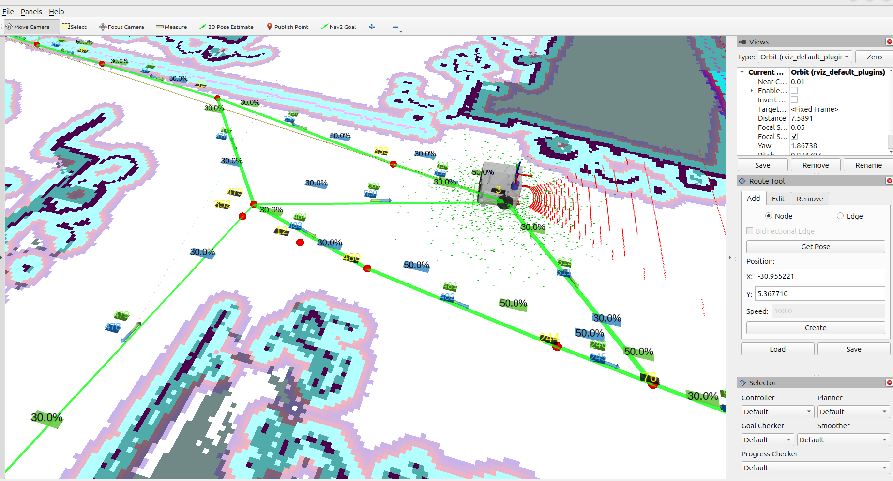

# Nav2 Route Tool Enhancements

Usability and visualization improvements for the **Route Tool**, the RViz panel used to build and edit [Nav2](https://github.com/ros-navigation/navigation2) route graphs, and for the route graph markers published by the Nav2 Route Server.



This repository contains the `nav2_route` and `nav2_rviz_plugins` packages from [ros-navigation/navigation2](https://github.com/ros-navigation/navigation2) at tag [`1.3.13`](https://github.com/ros-navigation/navigation2/tree/1.3.13) (ROS 2 Jazzy). The first commit is an unmodified import of those two packages, and **each later commit is one of the features below**, so the [commit history](https://github.com/marcospontoexe/nav2-route-tool-enhancements/commits/main) shows exactly what was added on top of Nav2.

## Features

### 1. One-click bidirectional edges
The **Add** tab has a **Bidirectional Edge** checkbox (Edge mode only). When it is checked, **Create** builds both `A → B` and `B → A` in one action, instead of creating each direction separately.

### 2. Direction arrows on every edge
The route graph markers now draw an arrow at the midpoint of each edge, pointing from its start node to its end node. Before, edges were plain lines, and the two directions of a bidirectional pair were drawn on top of each other. The arrows are color-coded:
- **Orange**: unidirectional edge
- **Green/yellow**: outbound edge of a bidirectional pair
- **Light blue**: return edge of a bidirectional pair

### 3. Readable node and edge ID labels
ID labels sit on a thin dark background plate, with larger text, more offset from the node or edge, and raised above the graph. Edge ID colors follow the same scheme as the arrows, so the ID, the arrow and the direction of an edge are visually tied together.

### 4. Speed limit field for new edges
In Edge mode, the **Add** tab has a **Speed** field, pre-filled with `100.0`. Its value is stored in the new edge's metadata as `speed_limit` (a float), so it is saved to the `.geojson` graph and used by Nav2's existing `speed_limit` consumers (`DistanceScorer`, `AdjustSpeedLimit`) without editing the graph file by hand.

### 5. Speed limit label on each edge
Edges that have a `speed_limit` show it near their **start node** (the ID label stays at the midpoint), as a percentage of the maximum speed (e.g. `100.0%`), on a background colored with the edge's own color. Edges without the key get no label. A value that was not stored as a float (e.g. `"speed_limit": 30` written without a decimal point) is skipped with a one-time warning instead of crashing the panel.

### 6. Get Pose button
In Node mode, **Get Pose** fills the X/Y fields with the robot's current position (TF lookup `map → base_frame`; `base_frame` defaults to `base_link` and is a ROS parameter of the panel's internal `route_tool_node`), so a node can be placed exactly where the robot stands. The lookup is non-blocking: if the transform is not available yet, it logs a warning and leaves the fields untouched.

This also fixes a bug in the panel: its `tf2_ros::Buffer` never had a `TransformListener` attached, so it never received any transform.

### 7. Arrow transparency from the edge penalty
Each arrow's transparency reflects the `penalty` metadata of **its own edge**, the value Nav2's `PenaltyScorer` adds to an edge's cost to discourage the route planner from using it:

```
alpha = 0.5 + 0.5 × (edge penalty / highest penalty in the graph)
```


*Edge 162 (node 16 → 158) has `"penalty": 10.0`, the only penalty in this graph, so its green arrow is fully opaque. Its reverse, edge 161 (158 → 16), has no penalty, so its blue arrow (like every other arrow) stays at alpha 0.5.*

Edges without a `penalty` count as `0.0` (the same default as `PenaltyScorer`) and keep alpha `0.5`, so the direction stays readable. Only the arrows change: the two arrows of a bidirectional pair never overlap, while the two directions' edge lines share the same segment, so per-direction transparency there would stack.

The markers only *read* the metadata. For the penalty to change the planned route, enable `PenaltyScorer` in the Route Server parameters:

```yaml
edge_cost_functions: ["DistanceScorer", "CostmapScorer", "PenaltyScorer"]
PenaltyScorer:
  plugin: "nav2_route::PenaltyScorer"
  weight: 1.0
```

Write numeric metadata with a decimal point (`10.0`, not `10`): the graph loader stores integers as `int`, and the scorers read `float`.

## Build and run

Tested on Ubuntu 24.04 with ROS 2 Jazzy and Nav2 `1.3.13` installed from apt (`sudo apt install ros-jazzy-navigation2`). These two packages overlay the apt versions of `nav2_route` and `nav2_rviz_plugins`.

```bash
mkdir -p ~/route_tool_ws/src && cd ~/route_tool_ws/src
git clone https://github.com/marcospontoexe/nav2-route-tool-enhancements.git
cd ~/route_tool_ws
source /opt/ros/jazzy/setup.bash
rosdep install --from-paths src --ignore-src -y
colcon build
source install/setup.bash
ros2 launch nav2_rviz_plugins route_tool.launch.py yaml_filename:=/path/to/map.yaml
```

The launch file opens RViz with the Route Tool panel already configured. The panel can also be added to any RViz instance via **Panels → Add New Panel → nav2_rviz_plugins → RouteTool**. To get the new markers from your robot's Route Server, source this workspace before launching Nav2. **Get Pose** needs the `map → base_link` transform, i.e. a robot or simulation with localization running.

## Credits and license

- Licensed under the [Apache License 2.0](LICENSE), like the original Nav2 code. Modified files say so in their header.
- `nav2_route` and the Route Tool are part of [Nav2](https://github.com/ros-navigation/navigation2); the Route Tool was originally written by John Chrosniak (2024). This repository is not affiliated with or endorsed by the Nav2 project.
- Enhancements by Marcos Daniel Santana Grochoska ([@marcospontoexe](https://github.com/marcospontoexe)), with [Erico Meger](https://github.com/EricoMeger) as co-author of features 1–4.
